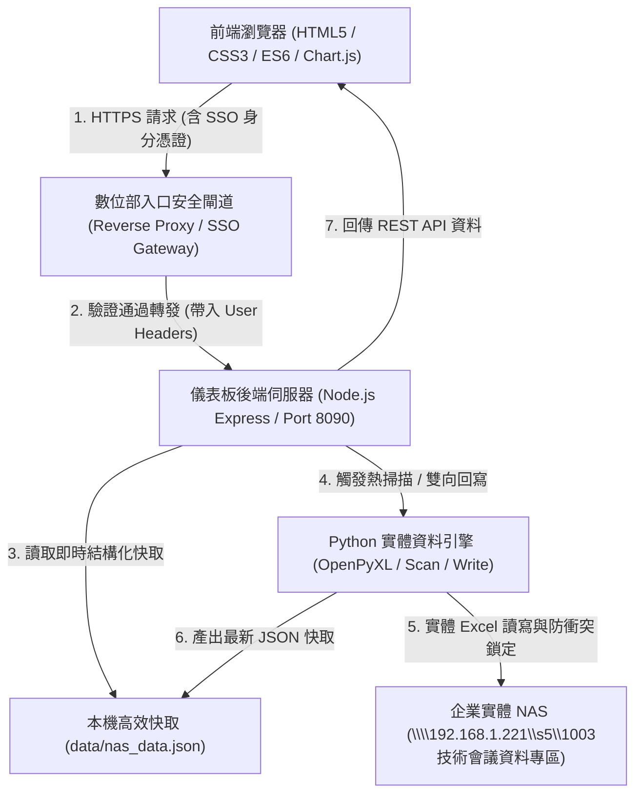

# 豐譽企業「技術會議雲端儀表板」數位部交接與入口權限加設開發手冊

> **專案代號**：`TechnicalMeetingDashboard`  
> **交接對象**：豐譽企業 數位資訊部（系統開發 / 資訊安全 / 基礎設施工程師）  
> **交接窗口**：技術暨品保處 甘銘鐘 經理  
> **發布版本**：`v76.1`（正式上線準備版）  
> **交付日期**：2026年11月  

---

## 目錄
1. [專案背景與系統定位](#一專案背景與系統定位)
2. [系統總體架構與流程圖](#二系統總體架構與流程圖)
3. [專案目錄結構清單](#三專案目錄結構清單)
4. [數位部核心任務：加設入口權限指南](#四數位部核心任務加設入口權限指南)
   - [現行驗證架構剖析](#41-現行驗證架構剖析)
   - [方案 A：企業 SSO / Microsoft Entra ID (Azure AD) 整合](#42-方案-a企業-sso--microsoft-entra-id-azure-ad-整合推薦)
   - [方案 B：反向代理標頭驗證 (Reverse Proxy Auth - Nginx / Traefik / IIS)](#43-方案-b反向代理標頭驗證-reverse-proxy-auth)
   - [方案 C：企業內部 Windows AD / LDAP 原生驗證](#44-方案-c企業內部-windows-ad--ldap-原生驗證)
   - [角色權限模型 (RBAC) 建議](#45-角色權限模型-rbac-建議)
5. [實體 NAS 儲存與網路環境配置](#五實體-nas-儲存與網路環境配置)
6. [後端 REST API 完整規格清單](#六後端-rest-api-完整規格清單)
7. [伺服器部署與環境搭建步驟](#七伺服器部署與環境搭建步驟)
8. [維運常見問答 (FAQ)](#八維運常見問答-faq)

---

## 一、專案背景與系統定位

「技術會議雲端儀表板」為技術暨品保處研發之高階戰情系統，已完成企業 NAS（`1003技術會議資料專區`）全量 9 大工程專案、353 筆待辦追蹤事項、169 案技術議題之自動索引與熱同步，並具備前後台雙向回寫實體 Excel 之核心能力。

### 核心功能模組：
1. **公告及指引中心**：
   - 內嵌技術會議專屬 Google 日曆（僅顯示技術會議時程，隔絕個人日曆）。
   - 運作概況動態統計（P10~P13、工處/工地指標雙向連動全量重算）。
   - 00發布區正式技術指引文件在庫檢索。
2. **各專案作業區**：
   - 9 大在建工程專案（CDC、台南崇明、平實、朴子、中油綠能等）。
   - 歷次會議簡報與紀錄極速熱掃描。
   - 工程議題管控表（多維篩選、雙擊即時編輯、雙向回寫實體 NAS Excel）。
   - 專案待辦事項追蹤表（依基準日動態重算完成率與逾期燈號）。
3. **全域資料搜索**：
   - Google AI Overview 深度技術萃取報告。
   - SPS 品保分享會 392 份結案與技術簡報全文直達檢索。
4. **BIM 作業區**：
   - Autodesk Construction Cloud (ACC) 與 Trimble Connect 雲端協同外連。

---

## 二、系統總體架構與流程圖



---

## 三、專案目錄結構清單

```text
technical-meeting-dashboard/
├── public/                       # 前端靜態單頁應用 (SPA)
│   ├── index.html                # 主畫面 HTML5 (包含側邊欄、展示區、登入遮罩)
│   ├── style.css                 # 科技深色玻璃擬態樣式表 (v76.1)
│   ├── app.js                    # 前端核心控制邏輯與 DOM 渲染器
│   └── assets/                   # 圖示與企業識別資源
│       ├── fengyu-logo-color.png # 豐譽彩色經典版四葉 LOGO (168px)
│       └── tech-meeting-icon.png # 技術會議專屬正圓圖標 (96px)
├── data/                         # 資料庫與快取層
│   ├── nas_data.json             # 全量 9 專案/管控表/待辦/議題結構化快取 (9.7 MB)
│   └── users.json                # 現行本機登入使用者帳密儲存表
├── docs/                         # 原始技術指引與說明文件
│   └── README_USER_MANUAL_WORK_PACKAGE.md
├── scan_nas.py                   # NAS 1003 資料專區全量掃描與解析器
├── write_nas_excel.py            # 前後台雙向回寫 NAS 實體管制表之 Python 引擎
├── sync_todo_excel.py            # NAS 共用區待辦追蹤彙整表秒級熱同步引擎
├── server.js                     # 後端 API 與靜態檔案託管伺服器 (Node.js)
├── package.json                  # Node.js 依賴定義
├── requirements.txt              # Python openpyxl 依賴清單
├── Dockerfile                    # 容器化建置設定
├── docker-compose.yml            # Docker Compose 快速啟動範本
├── ecosystem.config.js           # PM2 程序守護設定
├── 啟動技術會議儀表板.bat          # Windows 一鍵啟動批次檔
└── DIGITAL_DEPT_HANDOFF_MANUAL.md # 本交接手冊
```

---

## 四、數位部核心任務：加設入口權限指南

數位部同仁的主要任務是**將此系統整合至企業內部身分識別體系**，讓同仁以公司現有帳密或單一登入（SSO）進入，並依照身分劃分權限。

### 4.1 現行驗證架構剖析
- **現行機制**：
  - 前端：`public/index.html` 中的 `#login-modal` 彈窗。若 `localStorage.getItem("fy_tech_user")` 不存在即阻擋並要求登入。
  - 後端：`server.js` 中的 `/api/login` 端點，比對 `data/users.json`。
  - 預設帳號：`FU@fengyu.com.tw` / 密碼 `Aa34561297+b`。
- **改裝切入點**：
  - 數位部加設驗證後，可**直接移除或繞過前端 `#login-modal` 彈窗**，改由入口伺服器在 Response Header 或 Cookie 注入使用者資訊。

---

### 4.2 方案 A：企業 SSO / Microsoft Entra ID (Azure AD) 整合（推薦）

若公司使用 Microsoft 365 / Azure AD / Entra ID，建議以 **OpenID Connect (OIDC)** 實作：

1. **在 Azure AD 註冊應用程式**：
   - 重新導向 URI：`https://tech-meeting.fengyu.com.tw/auth/callback`
2. **在 `server.js` 引入 `@azure/msal-node` 或 `passport-azure-ad`**：
   ```javascript
   // 範例路由改裝
   app.get("/login", (req, res) => {
     // 導向 Azure AD 登入頁
   });
   app.get("/auth/callback", async (req, res) => {
     // 取得 Token、解析使用者電子郵件與部門 (如 ganmen@fengyu.com.tw)
     // 建立 Session 並轉跳至儀表板主畫面
   });
   ```
3. **前端自動辨識身分**：
   - 伺服器提供 `/api/me` 端點，回傳目前已驗證之身分：
     ```json
     {
       "email": "ganmen@fengyu.com.tw",
       "name": "甘銘鐘",
       "dept": "技術暨品保處",
       "role": "admin"
     }
     ```
   - 前端 `app.js` 於啟動時呼叫 `/api/me`，直接跳過密碼輸入。

---

### 4.3 方案 B：反向代理標頭驗證 (Reverse Proxy Auth)

若數位部透過 **Nginx / Traefik / Cloudflare Zero Trust / IIS ARR** 架設企業統一入口閘道：

1. **入口反向代理配置**：
   反向代理完成驗證後，將同仁工號或 Email 注入 HTTP Headers：
   ```nginx
   # Nginx 範例配置
   location / {
       proxy_pass http://127.0.0.1:8090;
       proxy_set_header X-Forwarded-User $remote_user;
       proxy_set_header X-User-Email $http_cookie_user_email;
       proxy_set_header X-User-Role $http_cookie_user_role;
   }
   ```
2. **`server.js` 中間件直接取用身分**：
   ```javascript
   server.on("request", (req, res) => {
     const userEmail = req.headers["x-user-email"] || req.headers["x-forwarded-user"];
     if (userEmail) {
       // 視為已通過公司網域驗證，允許操作
     }
   });
   ```

---

### 4.4 方案 C：企業內部 Windows AD / LDAP 原生驗證

若直接與內部 Active Directory 網域主控台驗證：
- 可使用 Node.js `ldapjs` 或 `activedirectory2` 套件。
- 在 `/api/login` 中，將使用者輸入的帳密直接對內部網域 DC (`ldap://192.168.1.xxx:389`) 進行 `authenticate`，無需在本地儲存任何密碼。

---

### 4.5 角色權限模型 (RBAC) 建議

建議數位部建立以下兩種角色權限：

| 角色層級 | 對應人員 | 檢視權限 (Read) | 寫入權限 (Write) |
| :--- | :--- | :--- | :--- |
| **技術管理員 (Admin)** | 技術品保處（甘經理）、高階長官 | 全站 9 專案、會議簡報、管制表、待辦彙整、搜尋、BIM | **具備寫入權限**：允許新增/編輯管制項目、修改待辦事項、雙向回寫實體 NAS Excel、觸發重新掃描 |
| **一般工程師 / 工地主管 (Viewer)** | 各工區工程師、各工程處主管 | 僅可查看所屬或全專案之會議簡報、排程、運作概況、SPS簡報 | **僅唯讀**：前台「修改」、「新增管制」按鈕自動隱藏或停用，阻擋 `/api/update-*` 請求 |

> **提示**：前端 `app.js` 中可透過全域變數 `window.currentUserRole` 控制修改按鈕之顯示狀態。

---

## 五、實體 NAS 儲存與網路環境配置

系統之後端需常態性存取公司實體 NAS：

1. **NAS 路徑**：
   $$\text{\\\\192.168.1.221\\s5\\1003技術會議資料專區}$$
2. **目錄重要結構**：
   - `0.共用區/`：放置《技術會議-待辦追蹤彙整表.xlsx》（全公司待辦核心彙總表）。
   - `1.各專案工作區/`：
     - `北區工程處/`、`總工區/`、`統包工程處/`、`台中工處/`、`台南工處/`
     - 內含各工區最新《技術議題管控表-*.xlsx》及歷次會議資料夾（`115xxxx技術會議/`）。
   - `2.技術會議運作指引(供查看及下載)/00發布區/`：正式指引文件（僅索引 00發布區）。
3. **主機服務帳號權限需求**：
   - 運行 `server.js` 的 Windows 伺服器或 Linux 主機，其執行使用者必須具有對 `\\192.168.1.221\s5\1003技術會議資料專區` 的 **讀取 (Read) 與 寫入 (Write)** 權限。
   - 若為 Linux 主機，請透過 CIFS / Samba 掛載至本地目錄（例如 `/mnt/nas_1003`），並相應修改 `server.js` 與 `scan_nas.py` 中的 `NAS_ROOT` 常數。

---

## 六、後端 REST API 完整規格清單

| 端點 (Endpoint) | 方法 | 說明 | 寫入實體 NAS |
| :--- | :--- | :--- | :--- |
| `/api/nas-data` | `GET` | 取得儀表板全量結構化資料 (專案、管控表、待辦、議題、指引) | 否 |
| `/api/login` | `POST` | 企業網域登入驗證（待數位部改接 SSO） | 否 |
| `/api/update-profile` | `POST` | 修改使用者個人密碼 | 否 |
| `/api/update-control-item` | `POST` | 新增/修改各專案技術管制項目 | **是 (呼叫 write_nas_excel.py 回寫專案 Excel)** |
| `/api/update-todo-item` | `POST` | 修改專案待辦事項 (進度、預定完成日、負責人) | **是 (呼叫 write_nas_excel.py 回寫共用區待辦表)** |
| `/api/reload-project-excel` | `POST` | 單一專案管制表即時熱同步更新 | 否 (熱讀取 NAS) |
| `/api/reload-project-meetings`| `POST` | 單一專案歷次會議資料熱掃描 | 否 (熱讀取 NAS) |
| `/api/reload-todo-excel` | `POST` | 共用區待辦彙整表秒級熱同步 | 否 (熱讀取 NAS) |
| `/api/rescan` | `POST` | 觸發全量 NAS 1003 專區後台完整重掃 (scan_nas.py) | 否 (全量重建快取) |
| `/api/update-cutoff-date` | `POST` | 更新全域統計基準日 (全量動態重算) | 否 |
| `/api/heartbeat` | `POST` | 15秒心跳在線維持機制 | 否 |
| `/api/view-file` | `GET` | 串流代理檢視 NAS 內部 PDF 檔案 | 否 |
| `/api/download` | `GET` | 下載 NAS 實體檔案 (簡報、Word、Excel) | 否 |
| `/api/open-file` | `POST` | 在伺服器端本機原生程式開啟檔案 | 否 |

---

## 七、伺服器部署與環境搭建步驟

### 7.1 本機 Windows Server 快速部署（推薦現行環境）

1. **安裝基礎執行環境**：
   - 安裝 **Node.js 18+ LTS** 或 20+。
   - 安裝 **Python 3.10+**，並將 python 加入系統環境變數 PATH。
2. **安裝專案依賴**：
   ```cmd
   cd technical-meeting-dashboard
   npm install
   pip install -r requirements.txt
   ```
3. **啟動伺服器**：
   - 測試運行：執行 `啟動技術會議儀表板.bat` 或 `node server.js`。
   - 常駐生產運行：
     ```cmd
     npm install -g pm2
     pm2 start ecosystem.config.js
     pm2 save
     pm2 startup
     ```
4. **驗證存取**：
   - 本地瀏覽器開啟：`http://localhost:8090`。

---

### 7.2 Linux / Docker 容器化部署

若數位部欲採用 Docker 叢集部署：
```bash
cd technical-meeting-dashboard
# 1. 建置映像檔
docker build -t fengyu/tech-dashboard:v76.1 .

# 2. 啟動容器 (需注意 NAS 掛載路徑映射)
docker-compose up -d
```

---

## 八、維運常見問答 (FAQ)

**Q1：同仁修改管控表或待辦事項時，實體 NAS Excel 會被鎖定嗎？**  
**A1**：`write_nas_excel.py` 內建檔案鎖定檢測機制。若有其他同仁正以 Microsoft Excel 開啟該檔案導致檔案被獨占鎖定，系統會主動回報錯誤並保留前端變動於佇列中，待鎖定解除後再行寫入，避免檔案損壞。

**Q2：如何更換「技術會議專屬 Google 日曆」？**  
**A2**：日曆 ID 設定於 `public/index.html` 的 `id="google-calendar-iframe"` 與 `public/app.js` 的 `cal_url`。若日後技術會議日曆有所遷移，僅需替換日曆 ID 即可無痛切換。

**Q3：SPS 品保分享會的 392 份簡報路徑在哪裡？**  
**A3**：目前設定於本機路徑 `C:\Users\ganmen\Desktop\202607AI\分享會簡報`，數位部可將其轉移至 NAS 統一目錄，並在 `parse_sharepoint.py` / `scan_nas.py` 中更新路徑即可。

---

**手冊編製完成 ‧ 祝數位部上線整合順利！如有任何技術細節需進一步說明，請隨時洽詢甘經理。**
